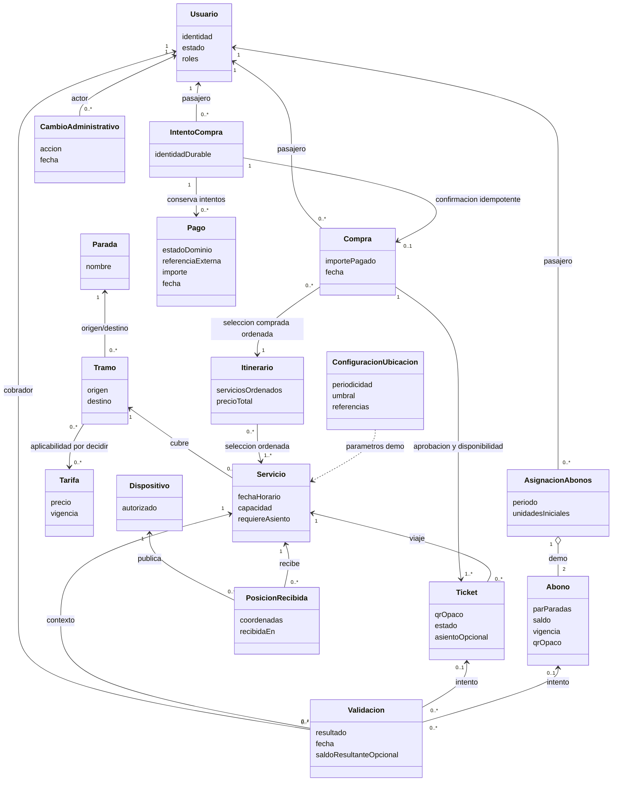
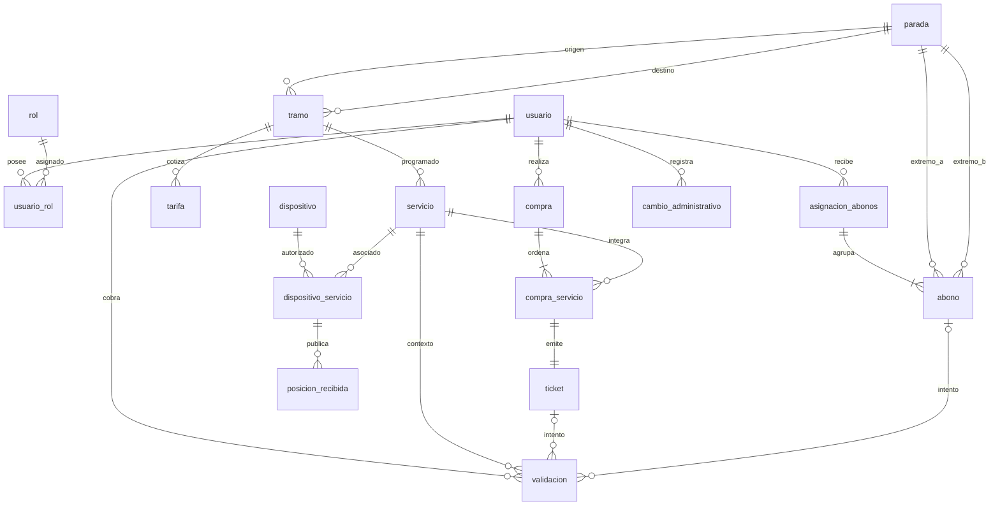

# Obligatorio Berruti — Modelo conceptual del MVP y persistencia candidata

**Estado: base conceptual evolutiva aprobada por Diego y Enzo, según lo informado por el usuario; no esquema físico aprobado.** Se registra esa aprobación humana reportada, sin atribuir al agente la revisión de ninguno de ellos ni inventar una fecha de revisión. Primero se representan conceptos y reglas del dominio en UML; luego una posible persistencia MySQL en ER. La aprobación admite cambios futuros; las cardinalidades y restricciones marcadas **propuesta** no autorizan por sí solas políticas comerciales ni contratos DTO definitivos. Fuentes: [MVP](mvp.md), [requisitos](../reference/requirements.md), [historias](../reference/user-stories.md) y [backlog](../tasks.json). No se encontró consigna oficial; contrastar este borrador con ella antes de implementar.

## 1. Dominio (UML)

Un itinerario es una selección ordenada de servicios, no necesariamente una entidad durable. Un tramo representa el par de paradas de un segmento; el «orden dentro de una ruta» del inventario preliminar del MVP §8 es provisional: la pertenencia y el orden en una ruta requieren definición posterior. La instancia fechada que se valida es el servicio. El abono habilita un par de paradas en ambos sentidos (RN-13), no necesariamente una única dirección de servicio.

Las asociaciones del diagrama expresan intención conceptual, no un esquema físico aprobado: un servicio puede aparecer en múltiples selecciones de itinerario; cada selección contiene uno o más servicios ordenados. Compra enlaza la selección comprada mediante el concepto existente Itinerario; el camino Compra → Ticket → Servicio identifica los servicios adquiridos, pero no expresa por sí solo su orden. La asociación con Itinerario expresa ese orden conceptual, no una tabla permanente ni una nueva entidad. Cada ticket emitido pertenece a exactamente una compra confirmada; la generación de todos los tickets ocurre junto con ella. El intento durable de compra agrupa y conserva los intentos de pago, aunque no llegue a existir compra confirmada. El acuerdo conceptual del usuario admite a lo sumo una compra confirmada por intento durable; no define su representación física ni la retención temporal de los registros. Cada validación resuelta refiere **exactamente un** ticket o abono si el QR existe; un QR desconocido no refiere ninguno. Un ticket admite muchos intentos, pero a lo sumo uno exitoso.

## 2. Persistencia candidata (ER MySQL)

La implementación actual de MVP-004 ya persiste `Pago` asociado al intento y conserva sus estados y clave de creación; este ER sigue siendo una propuesta conceptual y no representa ese esquema físico implementado. El inicio HTTP de checkout no confirma compra ni genera tickets: verificación, disponibilidad y emisión siguen siendo pasos posteriores.

Los nombres y campos siguientes son **propuesta técnica**, no migración. `itinerario` se materializaría al comprar mediante `compra_servicio` (orden y precio congelado); la búsqueda puede construir itinerarios sin guardarlos. El ER representa únicamente compras confirmadas tras aprobación verificada, disponibilidad confirmada y hold vigente: cada `compra_servicio` tiene exactamente un ticket emitido. El ER omite la relación física de pagos; el UML expresa ese vínculo conceptual, mientras que la implementación actual de MVP-004 sí conserva registros `Pago` ligados al intento. En el diagrama, las patas opcionales y las claves foráneas nulas de validaciones se explican abajo.

`configuracion_ubicacion` es una configuración académica versionable por vigencia, no una fuente de posiciones; no se dibuja relación obligatoria con cada servicio hasta decidir el alcance de parámetros. Una publicación aceptada siempre conserva su asociación dispositivo/servicio y recepción; intentos rechazados no crean `posicion_recibida`.

**Implementación de MVP-009 (decisión de Diego, 2026-11-10):** el dispositivo embarcado es el celular del cobrador, identificado por su sesión de rol `Cobrador`. Por eso `dispositivo` y `dispositivo_servicio` se implementan como `cobrador_servicio` (PK `usuario_id` + `servicio_id`, sembrada por el reinicio local), y `posicion_recibida` referencia esa asociación con `latitud`/`longitud` `decimal(9,6)` y `recibida_utc`. `configuracion_ubicacion` no se persiste: los parámetros viven en la sección `Ubicacion` de `appsettings.json` de la API. Las claves de las tablas nuevas siguen el GUID de las entidades operativas, no los prefijos `DI-`/`PR-`/`DS-`. Contrato: [API de ubicación](../reference/api.md#ubicación-de-demostración-mvp-009).

**Corte preparado de MVP-004 (secuencia por salida):** `parada_salida` conserva cada ocurrencia de una parada con PK (`salida_id`, `orden`); una misma `ParadaId` puede repetirse en distintos órdenes. `servicio` mantiene `salida_id` opcional y agrega `orden_embarque`/`orden_desembarque` opcionales, ambos nulos para filas legadas sin límites. Cuando se informan, ambos deben estar presentes, requerir una salida y cumplir embarque < desembarque; sus FK compuestas restringen ambos extremos a ocurrencias de esa misma salida con borrado `RESTRICT`. Para `SA-1`, el segundo servicio demo usa `[1,2)` (Radial–Colonia); el primer servicio sin asiento no cambia. Estas FK no prueban que las ocurrencias correspondan a los extremos de `Tramo`, ni disponibilidad u ocupación. El corte backend preparado añade servicio de creación/consulta de intentos, snapshots de la cotización ofrecida, asignación de asiento y holds por intervalo con transacción READ COMMITTED y bloqueo ordenado de filas `salida`. Tras los locks, la lógica compara cada servicio asignado con su `salida_id` inicial y exige que la fecha local `Servicio.Salida` coincida con `Salida.Fecha` leída en la misma consulta de lock; remapeos o fechas inconsistentes fallan antes de asignar IC o persistir. La validación de límites entre `Tramo` y ocurrencias `ParadaSalida` es lógica de aplicación. `IntentosCompraHold` y su SQL se generaron offline y no se aplicaron a una base; su `Down` rechaza la reversión automática antes de emitir operaciones para evitar borrar/reutilizar identidades `IC-`. Las pruebas fake/de metadatos no acreditan enforcement ni bloqueo concurrente en MySQL. La consulta `GET /api/intentos-compra/{intentoId}/cotizacion` usa el servicio de cotizacion para recotizar la secuencia original contra la tarifa vigente para la fecha local, conserva los horarios y la politica de asiento, y no persiste ni renueva el hold. Ante cualquier cambio de precio, el pasajero debe aceptar la oferta antes de un futuro checkout. Su huella SHA-256 liga intento, expiracion y precios actuales para comparar esa aceptacion despues; no firma datos ni autoriza pagos. Las pruebas directas no acreditan MySQL, checkout ni confirmacion de tickets.

### Estado actual del esquema de MVP-004

**Actualización del corte de persistencia (2026-11-16):** el esquema de intentos de pago, compra y ticket ya está modelado en EF Core y preparado en `PagosComprasTickets` más `scripts/database/pagos-compras-tickets.sql`; esa migración se generó offline y no se aplicó a MySQL. Esta actualización reemplaza las menciones anteriores de esta sección que dejaban las tablas físicas de Pago, Compra o Ticket pendientes. `pago` conserva el estado observado, importes y claves de idempotencia; `tramo_pago` congela el precio aceptado por cada intento de pago. Sus claves compuestas hacen que cada cotización por tramo pertenezca al mismo intento y pago. `compra` limita a una compra por intento y referencia un pago de ese mismo intento. `compra_servicio` conserva la secuencia y el importe por tramo, relacionado con el precio aceptado; `ticket` tiene QR opaco único y como máximo uno por servicio comprado. IDs persistentes usan `PG-`, `CO-`, `CS-` y `TI-`, con correlativos inicializados solamente por la migración.

El usuario aprobó una re-cotización autoritativa de la API antes de iniciar cada checkout: el pasajero debe aceptar cualquier cambio de precio. Se preserva la cotización inicial de `tramo_intento_compra`; cada precio aceptado se guarda aparte en `tramo_pago`, de modo que un rechazo, respuesta desconocida o reinicio no cambie el monto del pago ya intentado. Re-cotizar no reinicia el vencimiento original del hold de 15 minutos. El servicio de inicio de pago reserva el snapshot aceptado en una transacción corta antes de llamar al checkout externo, usa la clave persistida del pago y mantiene `Desconocido` ante resultados ambiguos; todavía no expone una ruta HTTP ni confirma compras o emite tickets. El repositorio bloquea el intento y revalida propiedad/pagos existentes al reservar, pero las pruebas fake no demuestran bloqueo ni enforcement de MySQL. Los checks de metadata tampoco demuestran aprobación de pago, atomicidad, al menos un tramo/ticket por compra ni disponibilidad por intervalo; faltan el endpoint HTTP, reconciliación/confirmación, emisión y recorridos runtime.

### Identificadores de las entidades

**Formato acordado por el usuario:** los IDs propios son valores reales de tipo `string`, no códigos decorativos sobre otra PK. Se usan abreviaturas de dos letras seguidas de un guion y un correlativo, como `PA-1`. Las tres posiciones iniciales son el prefijo completo (`PA-`), por lo que `Substring(3)` extrae el sufijo (`1`). El corte MVP-004 mantiene este formato para `Salida` e incorpora el prefijo `IC-` aprobado para intentos; no generaliza la asignación al resto de las identidades candidatas.

**Abreviaturas aprobadas explícitamente por el usuario en el chat, incluida `US-` para Usuario:** esta tabla organiza el modelo existente; no aprueba por sí sola nuevas tablas, migraciones ni contratos. Los ejemplos con `1` ilustran el formato y coinciden con el inicio aprobado abajo; no definen el mecanismo de generación; el rango aprobado se detalla abajo.

| Entidad o tabla candidata con identidad propia | Prefijo aprobado | Ejemplo |
| --- | --- | --- |
| Salida operativa (MVP-004) | `SA-` | `SA-1` |
| Usuario | `US-` | `US-1` |
| Parada | `PA-` | `PA-1` |
| Tramo | `TR-` | `TR-1` |
| Servicio | `SE-` | `SE-1` |
| Tarifa | `TA-` | `TA-1` |
| IntentoCompra | `IC-` | `IC-1` |
| Compra | `CO-` | `CO-1` |
| Pago | `PG-` | `PG-1` |
| Ticket | `TI-` | `TI-1` |
| AsignacionAbonos | `AA-` | `AA-1` |
| Abono | `AB-` | `AB-1` |
| Validacion | `VA-` | `VA-1` |
| Dispositivo | `DI-` | `DI-1` |
| PosicionRecibida | `PR-` | `PR-1` |
| ConfiguracionUbicacion | `CU-` | `CU-1` |
| CambioAdministrativo | `CA-` | `CA-1` |
| `rol` | `RO-` | `RO-1` |
| `compra_servicio` | `CS-` | `CS-1` |
| `dispositivo_servicio` | `DS-` | `DS-1` |

**Corte preparado de MVP-004 (2026-11-16):** `salida` usa `salida_id` prefijado `SA-` y una fecha local de viaje (`date`); `asiento_salida` identifica cada plaza mediante la PK compuesta (`salida_id`, `numero_asiento`) y no representa ocupación ni disponibilidad. `servicio.salida_id` es opcional y conserva aparte `salida_catalogo_id`. La fuente incluye inventario de demostración 1..46 para `SA-1`; el 46 es cantidad de ese escenario, no máximo global de la entidad. Se generaron la migración EF `InventarioSalidaDemo` y `scripts/database/inventario-salida-demo.sql`; permanecen preparados, no aplicados a ninguna base de datos. La asignación de IDs operativa queda fuera de este corte.

**No se asigna un ID nuevo a cada concepto:** Itinerario no exige tabla propia; `usuario_rol` conserva la PK compuesta propuesta (`usuario_id`, `rol_id`), sin prefijo adicional. Los prefijos técnicos anteriores solo aplicarían si se mantienen las identidades propias del ER candidato. `IntentoCompra` ya tiene representación física en el corte backend MVP-004; tablas de Pago y conceptos posteriores siguen pendientes. Usuario queda incluido en la regla con `US-` por confirmación explícita del usuario; esto no incorpora Identity/OpenIddict. La ampliación final no recibe identidades nuevas por esta tabla.

**Referencias y límites:** una FK hacia una identidad prefijada conservaría su valor `string` completo; no se reemplaza por el sufijo numérico. Los IDs no reemplazan QR opacos, credenciales de sesión ni referencias externas de pago y no conceden autorización. `Substring(3)` no valida el prefijo ni el número: antes de convertir el sufijo deben comprobarse formato y rango. La [referencia del ejemplo docente](../../.agents/skills/ctc-dda-blazor/references/prefixed-string-ids.md) explica la extracción y el máximo numérico, distintos del orden alfabético de strings.

**Política del correlativo aprobada explícitamente por el usuario en el chat; `IC-` se incorpora en el corte backend MVP-004:**

- Inicio en **1**, sin ceros de relleno: `PA-1`, `PA-9`, `PA-10`.
- Contador **independiente por entidad**: pueden coexistir `PA-1` y `US-1`.
- Los IDs **no se reutilizan tras borrados**; se aceptan huecos en la numeración.
- La **API asigna el ID**; el cliente no elige el identificador de un alta.
- Rango **de 1 a 50.000 inclusive por entidad**: por ejemplo, `PA-1` hasta `PA-50000`. Es un límite del proyecto, no del tipo numérico de C#.
- El límite corresponde a números asignados históricamente, no a la cantidad de registros existentes; borrar registros no libera sus números.
- Al agotarse el rango, la API debe **rechazar el alta con un error claro**, sin reiniciar en 1 ni guardar parcialmente. El texto y contrato concreto del error quedan para el diseño del alta.
- La validación exige el prefijo correspondiente y un sufijo entero entre 1 y 50.000 inclusive, sin ceros de relleno.

**Justificación de la no reutilización, aceptada explícitamente por el usuario en el chat:** un ID identifica un registro concreto, no un lugar libre. Si `PA-3` identificaba «Terminal», se borra y luego se asigna a «Plaza», una referencia antigua en un cliente, enlace o historial podría apuntar a otra parada. Es un escenario ilustrativo, no un incidente observado. Las claves foráneas ayudan a proteger las relaciones dentro de la base de datos, pero no todas las referencias externas. Conservar la identidad histórica evita esa ambigüedad; los huecos son válidos. No es una obligación técnica universal, sino una política elegida para este proyecto. Alcanzar el límite no autoriza reciclar números: una eventual ampliación del rango requeriría otra decisión.

**Mecanismo aprobado por el usuario:** contador durable por entidad, separado de los registros, con incremento transaccional y protección concurrente; formar el ID prefijado a partir del número asignado y conservar el contador tras borrados. El alta de intentos reutiliza `IContadoresRepository` dentro de la misma transacción; la migración es la única inicialización de `IC-`. `ReinicioLocal` no vuelve a insertar ese prefijo después de aplicar migraciones; el SQL aún no se aplicó. El ejemplo `Max + 1` sobre registros existentes por sí solo no garantiza estas propiedades.

**Pendiente de integración:** aplicar y probar en MySQL el incremento, locks, rollback, CHECK/FK e intervalo concurrente; la suite usa un transaction-contract fake, no una base real. El contador rechaza el agotamiento sobre 50.000 por su implementación compartida. La generación del SQL y la inspección del modelo no acreditan aplicación, enforcement, integración ni finalización del backlog.

### Diccionario y claves propuestas

| Tabla | Identidad y referencias propuestas | Integridad / nulabilidad propuesta |
| --- | --- | --- |
| `usuario`, `rol`, `usuario_rol` | PK `usuario_id`, `rol_id`; puente PK (`usuario_id`, `rol_id`) y dos FK | Identidad académica única; credencial segura fuera de este diseño; estado requerido. |
| `parada`, `tramo` | PK respectivas; tramo FK `origen_id`, `destino_id` | Ambos extremos NOT NULL y distintos; unicidad direccional del par por decidir con rutas. |
| `servicio` | PK `servicio_id`, FK `tramo_id` | Salida y llegada (`datetime(6)`, hora local de Uruguay, con `llegada > salida`), capacidad positiva y `requiere_asiento` NOT NULL. Sin cupos inferidos de la venta hasta definir política. |
| `tarifa` | PK `tarifa_id`, FK `tramo_id` **provisional** | Importe no negativo, vigencia; aplicabilidad a tramo o servicio y solapamiento de vigencias pendientes. |
| `compra` | PK `compra_id`, FK `pasajero_id` | Fecha e importe total congelado no negativo; existencia final solo tras aprobación verificada por API, disponibilidad confirmada y hold vigente. |
| `compra_servicio` | PK `compra_servicio_id`, FK `compra_id`, `servicio_id` | `orden` positivo, UNIQUE (`compra_id`, `orden`); `precio_aplicado` no negativo congela importe por tramo. Conexión, suma y secuencia se verifican en API. |
| Intento durable de compra | `intento_compra` (PK `intento_id`, FK `usuario_id`) y `tramo_intento_compra` (PK (`intento_id`, `orden`), FK de servicio, snapshot de cotización) preparados en MVP-004 | Conserva propietario, creación UTC, vencimiento original y los datos necesarios para reconstruir la respuesta existente. La cotización guardada no fija el precio final del pago. |
| Hold de asiento e intentos de pago | `hold_asiento` preparado con PK (`intento_id`, `orden`), referencias a selección, inventario y ocurrencias `ParadaSalida`; tablas de pago siguen pendientes | El vencimiento deriva del intento, sin deadline duplicado. Se protegen solo asientos asignados y holds vigentes; no se infiere cupo de venta para tramos sin asiento. Política y representación física de pagos siguen pendientes; no se adopta la anterior FK opcional `pago.compra_id`. |
| `ticket` | PK `ticket_id`, FK `compra_servicio_id`, FK pasajero derivable de compra | UNIQUE `qr_opaco`, UNIQUE `compra_servicio_id` (un ticket por tramo comprado), asiento NULL solo si el servicio no lo requiere; vencimiento/estado y asiento coherentes en API. |
| `asignacion_abonos`, `abono` | PK respectivas; asignación FK `pasajero_id`; abono FK `asignacion_id`, `extremo_a_id`, `extremo_b_id` | Vigencia, estado, unidades iniciales y saldo; `0 <= saldo <= iniciales`, extremos distintos, UNIQUE QR. Exactamente dos por asignación de demo, iguales unidades iniciales y saldos independientes: transacción API, no CHECK entre filas. |
| `validacion` | PK `validacion_id`; FK `cobrador_id`, `servicio_id`; FK `ticket_id` y `abono_id` NULL | Fecha, resultado requeridos; ambos FK NULL solo para código desconocido, nunca ambos presentes; código presentado opaco registrado con política de privacidad por definir, saldo resultante NULL salvo consumo de abono. Intentos fallidos no consumen. |
| `dispositivo`, `dispositivo_servicio`, `posicion_recibida` | PK respectivas; puente FK `dispositivo_id`, `servicio_id`; posición FK `dispositivo_servicio_id` | Autorización/asociación vigente verificada en API; latitud/longitud completas y dentro de rango, `recibida_en` NOT NULL. Conservar posiciones aceptadas sin prometer analítica; última = recepción más reciente del servicio. |
| `configuracion_ubicacion` | PK `configuracion_id` | Periodicidad y umbral positivos, referencias académicas configurables; cálculo no persistido como precisión garantizada. |
| `cambio_administrativo` | PK `cambio_id`, FK `actor_id` | Acción, objeto afectado y fecha requeridos para operaciones delimitadas en RF-007; no duplicar estados de negocio. |

**Alcance revisable de pagos:** la propuesta vigente usa la API de Mercado Pago con credenciales TEST y escenarios de prueba del proveedor, sin cobro real. Hay un cliente interno de Checkout Pro Orders con pruebas HTTP simuladas para crear órdenes, consultar estado y solicitar una devolución completa; todavía no hay endpoints de pago, persistencia, reconciliación orquestada ni conexión Web/Mobile. La API deberá verificar el resultado del proveedor antes de emitir tickets, nunca confiar en el éxito indicado solo por el cliente. El adaptador valida referencia externa del pago local, importe y moneda, y solo considera aprobado `processed/accredited` con el importe completo; reembolsos parciales o totales no se consideran aprobaciones. El formato monetario de respuestas se interpreta estrictamente con cultura invariante. La solicitud de devolución no acredita su finalización; una consulta autoritativa posterior debe confirmarla. TEST real, seguimiento de devoluciones, emisión, representación física y producción permanecen pendientes; producción requiere otra decisión explícita.

### Acuerdo conceptual de compra, hold y reintentos

**Acuerdo conceptual incluido en la base evolutiva aprobada por Diego y Enzo, según lo informado por el usuario.** Un intento durable de compra agrupa intentos de pago conservados; es distinto del hold temporal y de una compra confirmada. El acuerdo conjunto previo definía cinco minutos; por actualización explícita del usuario, la duración vigente es **15 minutos configurables desde su creación en la API**, sin atribuir este cambio a una nueva aprobación conjunta. El corte backend preparado configura un valor positivo con default 15, fija el deadline al crear y no lo renueva al consultar. Recargar/reintentar, idempotencia de creación y pagos no están implementados ni definidos por este corte.

| Situación | Regla acordada |
| --- | --- |
| Rechazo definitivo con hold vigente | Permite otro pago dentro del mismo intento durable y del tiempo restante; conserva el anterior y el vencimiento original. |
| Pago pendiente o resultado desconocido, incluida falla de red | Bloquea otro pago hasta resolución autoritativa de la API, incluso después de vencer el hold; perder la respuesta no demuestra rechazo. |
| Aprobación verificada por la API, disponibilidad confirmada **y confirmación API antes del vencimiento original** | Puede confirmar una sola compra y sus tickets idempotentemente; solicitudes o notificaciones repetidas no deben duplicarlos. La igualdad con el vencimiento ya está expirada. |
| Vencimiento del hold | Libera el asiento para ese intervalo, pero no demuestra rechazo del pago ni resuelve un resultado pendiente/desconocido. |
| Aprobación después del vencimiento | No confirma compra ni emite tickets, aunque el asiento siga disponible. Registrar y seguir compensación/devolución hasta confirmación autoritativa; solicitarla no equivale a haber devuelto el pago. |

**Mecanismos pendientes, no política indecisa:** pagos, seguimiento de devolución, checkout, verificación y mapeo del proveedor. El esquema físico de intento y hold y el protocolo transaccional están preparados en fuente/migración: creación y revisión de disponibilidad ocurren en una transacción corta READ COMMITTED, que bloquea las salidas afectadas en orden ordinal estable y vuelve a leer los servicios tras el lock. Antes de asignar IC, el servicio confirma que cada `salida_id` asignado no cambió desde la lectura inicial y que `Servicio.Salida` (hora local de Uruguay) cae en la fecha de la fila `Salida` bloqueada; si el destino cambió aunque otra salida también esté bloqueada, o la fecha no coincide, falla cerrado sin intentar un lock tardío. Las pruebas fake no demuestran bloqueo o rollback en MySQL; el SQL está generado y no aplicado. El lock no se mantiene durante los quince minutos ni durante llamadas a proveedores. No hay cuota inferida para servicios sin asiento, ni comprobación de ocupaciones confirmadas porque esa entidad no existe aquí; se protegen holds de asientos solamente. La política aprobada compara la hora UTC de confirmación de la API —no una hora de aprobación del checkout— contra el vencimiento original; solo confirma estrictamente antes de esa fecha y con disponibilidad confirmada. Igualdad, demora posterior o falta de disponibilidad requieren seguimiento de devolución. La política pura preparada en `PoliticaConfirmacionCompra` valida offsets UTC, pero aún no está integrada en runtime ni persistida. Pendientes son el mapeo del proveedor, checkout y ejecución/confirmación de devoluciones; una solicitud de devolución no demuestra que haya concluido. El soporte de devoluciones del checkout/proveedor en TEST no está verificado y **no se autoriza un reemplazo simulado**. No hay integración ni pruebas del proveedor ejecutadas. La aprobación sola no autoriza emisión sin disponibilidad y hold vigente.

**Fuera del acuerdo:** transbordos todo-o-nada, límites por usuario, corte antes de salida, cancelación/renovación y reintento después del vencimiento permanecen abiertos; no inferirlos de este hold.

### Escenarios esperados para revisión de Enzo

Checklist de diseño para implementación y revisiones futuras, **no pruebas ejecutadas**. La aprobación conceptual conjunta reportada por el usuario no acredita ejecución individual de estos escenarios; por eso permanecen sin marcar:

- [ ] Aprobación activa: API verifica aprobación, disponibilidad y hold vigente; una sola compra y sus tickets.
- [ ] Rechazo definitivo: reintenta durante el tiempo restante, conserva pagos y no reinicia el vencimiento.
- [ ] Pendiente/desconocido: también ante falla de red, bloquea otro pago hasta resolución autoritativa, aun vencido el hold.
- [ ] Hold vencido: libera el asiento/intervalo sin declarar rechazo ni resolver el pago.
- [ ] Aprobación posterior al vencimiento: no emite ni confirma aunque haya lugar; sigue devolución sin declararla completada hasta confirmación autoritativa.
- [ ] Notificación duplicada: no duplica compra, tickets ni efectos de compensación; distinguir notificación tardía de aprobación tardía sigue siendo cuestión de diseño.
- [ ] Holds superpuestos: no protegen simultáneamente el mismo asiento/salida en intervalos superpuestos; mecanismo de concurrencia pendiente.

**Restricciones candidatas:** PK/FK y UNIQUE para QR, orden e identidad impiden referencias rotas y duplicados directos; CHECK de cantidades, importes y coordenadas restringe filas individuales. Para un solo uso se puede añadir indicador de consumo único en ticket y unicidad parcial mediante estrategia compatible con MySQL, pero el índice concreto queda para implementación. Tras verificar la aprobación con el proveedor, confirmar disponibilidad y comprobar hold vigente, la API debe crear compra y emisión completa de forma atómica e idempotente. También se propone transacción para asignación doble y validación con actualización condicional de estado o saldo y registro de intento; ante dos consumos simultáneos de ticket o última unidad solo uno confirma. FKs/CHECK por sí solos no verifican ruta conectada, pago aprobado, vigencia/autorización, asiento disponible por servicio ni igualdad entre dos filas. Las comprobaciones de asiento asignado automáticamente en Radial–Colonia son parte confirmada de la demo; los mecanismos de unicidad/capacidad y del hold acordado siguen sin definir.

## 3. Límites y trazabilidad

| Contrato | Cobertura del modelo | Fuente |
| --- | --- | --- |
| Identidad y configuración | Usuario/rol, paradas, tramos, servicio, tarifa, auditoría | RF-001/002/007; US-001/002/009; RN-12 |
| Itinerario y compra | Orden, precio congelado, pago aprobado/rechazado, ticket por servicio | RF-003/004; US-003/004; RN-01/02/05/06/07; CA-01/02/03 |
| Validación | QR opaco, intento desconocido o rechazado, ticket único, abono con saldo independiente | RF-005/006; US-005 a US-008; RN-03/04/08/09/10/11/13; CA-04 a CA-09; RNF-002/003 |
| Ubicación | Posiciones recibidas aceptadas y parámetros para última posición/estimación | RF-008/009; US-010 a US-012; RN-14/15; CA-11 a CA-14 |

El **dominio** expresa reglas y comportamiento; las tablas son una alternativa de almacenamiento y no contratos públicos. Los **DTO de API**, aún no definidos, deberán separar datos de compra, consulta y validación de las entidades persistidas: nunca exponer credenciales, precio mutable como precio pagado ni el estado completo dentro del QR. Para código inexistente, el DTO responde rechazo aunque `validacion` no tenga FK de recurso; una llamada sin autorización puede rechazarse antes de registrar un intento. Posiciones inválidas nunca reemplazan la última válida.

## 4. Decisiones abiertas para revisión humana

1. ¿Tarifa por tramo o por servicio y qué vigencia aplica al precio congelado? El FK de `tarifa` es provisional.
2. ¿Cómo se persiste el intento durable de compra que agrupa intentos de pago conservados y genera a lo sumo una compra confirmada? El vínculo conceptual y las reglas de reintento están acordados en §2; tablas, claves e índices siguen abiertos. También quedan por elegir producto de checkout, mapeo de estados externos y modo de verificar el resultado sin confiar en el cliente, además de persistencia/liberación del hold, comparación temporal autoritativa y ejecución/confirmación de devoluciones según la política acordada.
3. ¿Existe ruta persistida con orden propio o alcanza el tramo entre paradas y la secuencia de servicios? No equiparar ruta y tramo sin consigna.
4. ¿Cómo se vincula cada abono bidireccional con servicios y tramos inversos al validar? RN-13 autoriza ambos sentidos, no define la representación de rutas.
5. ¿Se conservan todos los intentos de validación, incluido QR desconocido, y con qué política de retención del código presentado? La referencia exclusiva a ticket/abono y las respuestas de API deben acordarse juntas.
6. ¿Qué garantiza la unicidad de asiento por servicio y qué ocurre ante concurrencia/cupo lleno? La asignación automática de la demo ya está decidida, no su algoritmo ni el mecanismo concurrente del hold por asiento/salida/intervalo acordado en §2.

**Puertas de dominio para implementación:** la aplicabilidad y vigencia de tarifas (1) y la correspondencia bidireccional abono–servicio (4) requieren decisiones futuras explícitas antes de implementar esas funciones; no son elecciones aprobadas por omisión ni por el FK provisional. La aprobación reportada acepta esta base conceptual evolutiva con esas puertas abiertas. Las restantes preguntas físicas y operativas también deben resolverse y revisarse en su ámbito antes de derivar migraciones o contratos definitivos; no se aprueba aquí el esquema físico.

## 5. Modelo conceptual complementario de la entrega final

**Propuesta complementaria, no esquema aprobado ni implementación.** Las mejoras del equipo se delimitan en [alcance final](../reference/final-scope.md); no son exigencias académicas explícitas. El UML/ER MVP incorpora el acuerdo conceptual de §2, sin resolver las preguntas físicas y operativas anteriores. Estos conceptos permiten discutir la ampliación sin decidir silenciosamente cómo migrar `tramo`, `servicio`, tarifas, pagos o abonos existentes.

| Concepto candidato | Relación e invariante de diseño |
| --- | --- |
| Ruta dirigida / variante | Secuencia de paradas con sentido explícito; variantes no comparten órdenes numéricos por inferencia. |
| Parada en ruta | Pertenencia y orden local; identificar la ocurrencia ordenada evita confundir visitas a una misma parada. |
| Calendario de operación | Días hábiles, fines de semana, feriados, vigencia y excepciones por bloque/variante; fuente acordada y transcripta en FIN-001. |
| Salida | Instancia fechada de una ruta dirigida, con secuencia y vehículo asignado; en FIN-001 genera `Servicio` MVP por par de paradas con hora publicada; vehículo pendiente (FIN-002). |
| Vehículo / configuración | Vehículo asignado determina plano académico 22/28/42/46; configuración contiene filas, posiciones y números únicos de asiento. |
| Asiento de salida | Identidad de inventario = salida + asiento de su configuración; reutilizar vehículo no comparte inventario entre salidas. |
| Ocupación confirmada | Asiento de salida e intervalo de embarque/desembarque válido de esa misma ruta/salida; no permite superposiciones. |
| Selección / intento de compra | Selección de cliente no es ocupación confirmada. El intento durable agrupa pagos conservados y genera a lo sumo una compra confirmada según §2; duración vigente del hold: 15 minutos configurables según §2; representación física y mecanismos pendientes. La duración conjunta histórica de 5 minutos se registra allí como antecedente. |

Relaciones propuestas: una ruta dirigida contiene una secuencia de ocurrencias de parada y puede generar múltiples salidas según calendario; una salida usa un vehículo y su configuración, que define los asientos ofrecidos. Un asiento de salida admite múltiples ocupaciones solamente en intervalos no superpuestos. Un itinerario con transbordo refiere varias salidas y requiere selección/asignación independiente en cada una.

La regla formal `[a,b)` contra `[c,d)` y sus ejemplos se mantienen en [disponibilidad por intervalo](../reference/final-scope.md#4-disponibilidad-por-intervalo), junto con [estados de compra y discusiones históricas](../reference/final-scope.md#5-compra-y-estados-de-experiencia). El acuerdo actual de §2 rige la política de hold/reintentos/aprobación tardía reflejada allí; no sustituye sus requisitos ni los estados y criterios de finalización del [backlog vigente](../tasks.json). La confirmación atómica/idempotente del servidor es un acuerdo conceptual todavía sin implementación: PK/FK o un UNIQUE por asiento/salida no bastan para permitir reutilización y excluir superposición. Estrategia transaccional, representación física e índices requieren diseño y pruebas; no se proponen migraciones aquí.

**Relación ruta/salida con el MVP (decisión de Diego, FIN-001):** el catálogo es un conjunto de tablas aparte (`bloque_horario`, `ruta`, `parada_ruta`, `salida_catalogo`, `hora_salida`, `feriado`, `excepcion_calendario`) que **genera** `Servicio` fechados: uno por cada par de paradas con hora publicada en cada salida y día. Así la búsqueda, la administración, Mobile y la compra (MVP-004) siguen usando `Tramo` y `Servicio` sin cambios; `servicio.salida_catalogo_id` (opcional) registra el origen. Rediseñar la disponibilidad por intervalo sobre la salida completa queda para FIN-003. Detalle de contratos en la [API](../reference/api.md#catálogo-de-horarios-fin-001).

**Puertas pendientes:** configuración ante cambio de vehículo y mecanismos de hold/pago/devolución TEST. La política del hold y de aprobación posterior al vencimiento está acordada en §2; una entidad física de reserva temporal y sus estados no se dan por aprobados. No cambia la limitación TEST/sin producción ni se resuelven tarifa, checkout, implementación de reintentos, abonos o retención de validaciones. Las reglas conceptuales de §2 sí están acordadas; alcance y backlog remiten a este acuerdo sin cambiar sus requisitos, estados de tareas ni autoridad para acreditar finalización. La evidencia de horarios y sus límites está en [catálogo y fuente](../reference/final-scope.md#2-catálogo-y-evidencia-de-horarios); capacidades y planos no prueban asignaciones reales. La revisión cruzada debe preceder contratos definitivos.
